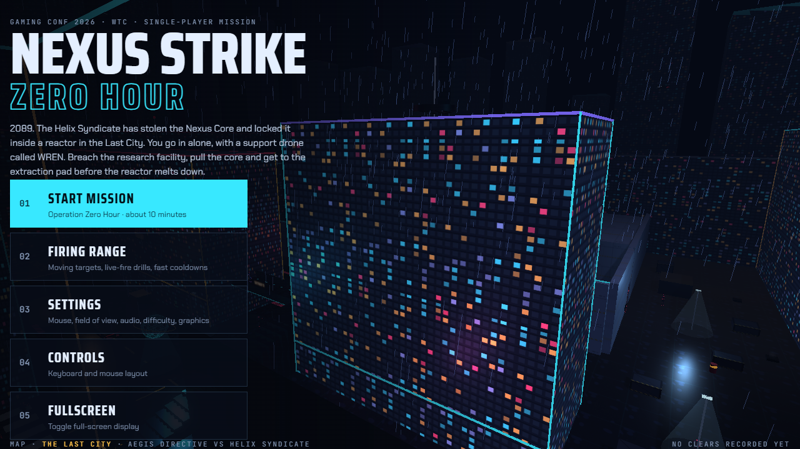
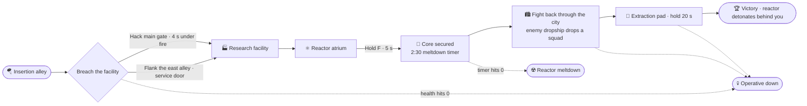
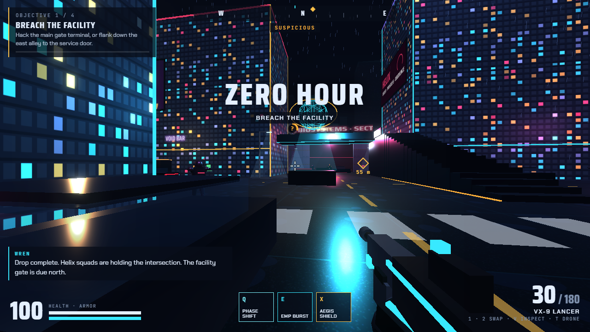
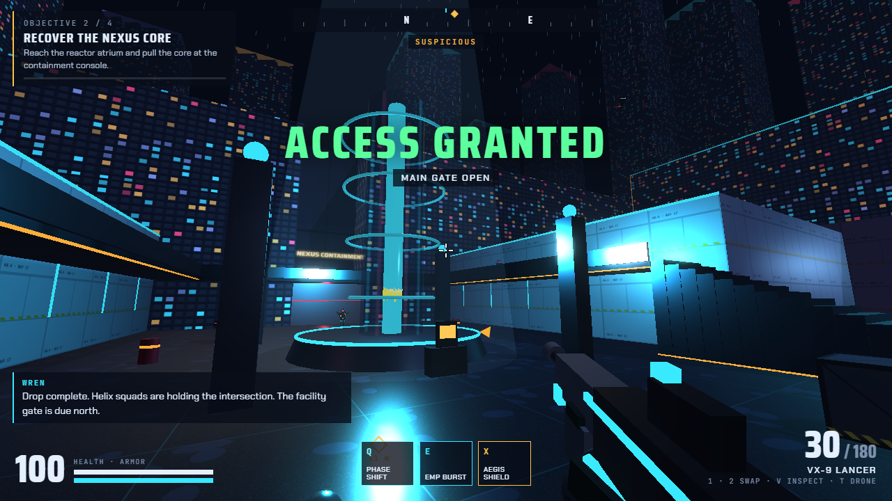
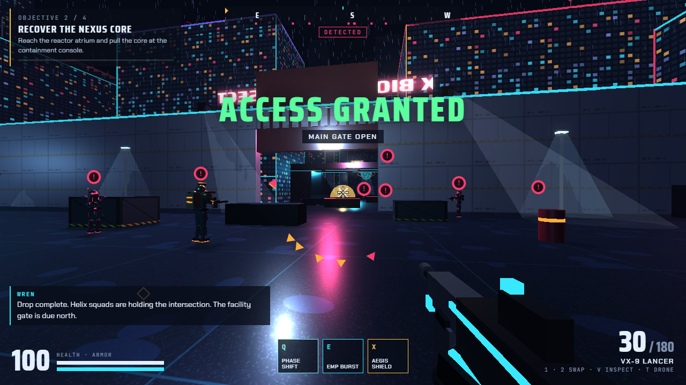
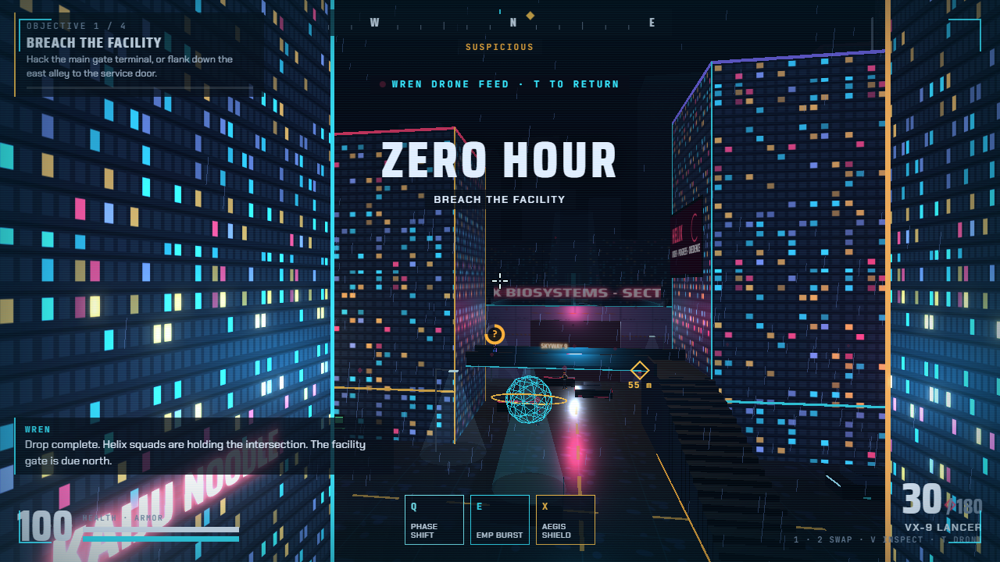

<div align="center">



# ⚡ NEXUS STRIKE: ZERO HOUR

**A tactical first-person shooter mission that runs in your browser.**
Built for **Gaming Conf 2026 · WTC**.

[](https://nexus-strike-zero-hour.vercel.app)


</div>

---

```
> INCOMING TRANSMISSION · AEGIS DIRECTIVE · PRIORITY ZERO
> 2089. THE LAST CITY. SECTOR 9 IS UNDER HELIX CURFEW.
> THE NEXUS CORE HAS BEEN STOLEN AND LOCKED INSIDE A HELIX REACTOR.
> YOU GO IN ALONE WITH ONE SUPPORT DRONE, CALLSIGN WREN.
> GET IN. PULL THE CORE. GET OUT BEFORE THE REACTOR GOES.
> ▮
```

<div align="center">

### 🎮 [ PRESS START ](https://nexus-strike-zero-hour.vercel.app)

*Desktop Chrome or Edge · keyboard and mouse · click once inside the game to lock the mouse*

</div>

---

## 🗺️ The mission

Every arrow below is a real game state. You can fail at any red box.



<table>
<tr>
<td width="50%"><br><sub><b>01 · The intersection.</b> Patrols, a marksman on the skybridge, cover everywhere.</sub></td>
<td width="50%"><br><sub><b>02 · The reactor.</b> The core sits inside. Pulling it starts the countdown.</sub></td>
</tr>
<tr>
<td width="50%"><br><sub><b>03 · Detected.</b> "!" markers show who has seen you.</sub></td>
<td width="50%"><br><sub><b>04 · WREN drone feed.</b> Press <kbd>T</kbd> to scout from above.</sub></td>
</tr>
</table>

---

## 🧬 Operator loadout

<details>
<summary><b>🔫 Weapons</b> · click to inspect</summary>

| Weapon | Type | Damage | Headshot | Fire rate | Magazine |
|---|---|---|---|---|---|
| **VX-9 Lancer** | Automatic rifle | 30 | ×3.4 | 640 rpm | 30 |
| **M-7 Marrow** | Semi-auto pistol | 34 | ×3.0 | 380 rpm | 12 |

Recoil climbs the longer you spray. Moving, jumping and firing from the hip all widen your spread. Crouching and aiming down sights tighten it.
Press <kbd>V</kbd> to play the inspect animation.

</details>

<details>
<summary><b>🌀 Abilities</b> · click to inspect</summary>

| Key | Ability | What it does | Cooldown |
|---|---|---|---|
| <kbd>Q</kbd> | **PHASE SHIFT** | Dash about 7 m in your move direction. Bullets miss you mid-dash. | 7 s |
| <kbd>E</kbd> | **EMP BURST** | Stuns every enemy within 10 m for 3.5 s. They can't shoot, and street lights flicker. | 18 s |
| <kbd>X</kbd> | **AEGIS SHIELD** | Blocks all incoming damage for 4 s. A hex barrier shows each blocked hit. | 22 s |

None of them deal damage. You still have to aim.

</details>

<details>
<summary><b>🛸 WREN, your support drone</b> · click to inspect</summary>

- Flies at your shoulder and fires on enemies who are in combat with you.
- Talks you through the mission over the comms channel.
- <kbd>T</kbd> switches to **WREN's drone feed**, an overhead tactical camera that marks every hostile through walls. You can't fire while it's on.

</details>

---

## 👾 Threat dossier

| Hostile | Threat | Health | How it fights | How to beat it |
|---|---|---|---|---|
| **Helix Trooper** | 🟥🟥⬜⬜ | 100 | Patrols, investigates noise, takes cover, peeks out to shoot, calls in friends | Flank its cover, or EMP it and push |
| **Helix Bulwark** | 🟥🟥🟥⬜ | 260 · armored | Ignores cover and walks you down with long bursts | Headshots skip its armor. Barrels hurt |
| **Helix Marksman** | 🟥🟥🟥🟥 | 80 | Holds high ground and charges a **red laser** before each shot | Laser on you means break line of sight |

**Enemy awareness:** a yellow **?** meter fills while an enemy can see you. Crouching fills it more slowly and sprinting fills it faster. At **!** they open fire and alert everyone within about 28 m. The top of your HUD reads `HIDDEN` / `SUSPICIOUS` / `DETECTED`.

---

## 🏆 Achievements

Copy this list into an issue or your notes and tick them off as you play.

- [ ] **Boots on the ground** · finish the intro flyover without skipping
- [ ] **Ghost protocol** · reach the facility gate while still `HIDDEN`
- [ ] **Side door** · breach through the east service door instead of the main gate
- [ ] **Bulwark breaker** · take down a Helix Bulwark with headshots only
- [ ] **Chain reaction** · kill two enemies with one explosive barrel
- [ ] **Laser dodger** · Phase Shift out of a marksman's red laser
- [ ] **Triple threat** · get a `TRIPLE KILL` callout
- [ ] **Unbreakable** · block 200 damage with Aegis in one run (shown on the results screen)
- [ ] **Zero hour** · finish the mission with under 30 seconds on the meltdown timer
- [ ] **S rank** · earn an **S** mission grade
- [ ] **Range master** · clear the firing range live-fire drill in under 10 seconds

---

## ⌨️ Controls

| | | | |
|---|---|---|---|
| <kbd>W</kbd><kbd>A</kbd><kbd>S</kbd><kbd>D</kbd> Move | <kbd>Shift</kbd> Sprint | <kbd>C</kbd> Crouch | <kbd>Space</kbd> Jump |
| 🖱️ Left click Fire | 🖱️ Right click Aim | <kbd>R</kbd> Reload | <kbd>1</kbd> <kbd>2</kbd> / wheel Switch |
| <kbd>Q</kbd> Phase Shift | <kbd>E</kbd> EMP Burst | <kbd>X</kbd> Aegis Shield | <kbd>T</kbd> Drone view |
| <kbd>F</kbd> Interact (hold) | <kbd>V</kbd> Inspect | <kbd>Esc</kbd> Pause | |

---

## 🎛️ What's under the hood

<details>
<summary><b>Systems that make it a game, not a demo</b></summary>

- **Movement:** first-person physics with gravity, step-up stairs, collision against every wall and crate, jumping, sprinting and crouching.
- **Combat:** hitscan shooting with head and body hitboxes, recoil, spread, reloads, ejected shell casings, bullet holes and tracers.
- **Enemy AI:** an A\* pathfinding grid over the whole map, cover selection with peek-and-fire cycles, flinching when hit, search behaviour and squad alerts.
- **Interactive world:** shootable glass, chain-reacting explosive barrels, animated blast doors, hackable terminals, med stations and an ammo locker.
- **A living city:** holographic billboards, flying traffic, rooftop turbines, a sweeping crane, searchlights, steam vents, rain, and a reactor with live energy arcs.
- **Kill feedback:** hit markers, slow motion on headshots, multi-kill callouts, and enemies breaking apart into energy shards.
- **Adaptive music:** a synthesised score that shifts from calm (menu) to a stealth pulse, combat drums, then a faster escape tempo.
- **3D sound:** gunfire, footsteps and dropship engines are positioned in space around you.
- **Presentation:** an intro cinematic, a victory cinematic, defeat screens, checkpoints and a mission grade (S, A, B or C).
- **Performance:** static map geometry is merged at load (about 370 meshes become about 18), and resolution adjusts automatically to hold the frame rate.

</details>

<details>
<summary><b>Tech stack</b></summary>

| Layer | Choice |
|---|---|
| Rendering | [Three.js r128](https://threejs.org) · WebGL · UnrealBloom post-processing |
| Geometry | All procedural. No models, no image files, no audio files |
| Audio | Web Audio API · HRTF spatial panning · synthesised SFX and music |
| Hosting | Static site on [Vercel](https://vercel.com) |
| Build | One self-contained `index.html` |

</details>

---

## 🚀 Run it yourself

```bash
git clone https://github.com/SahanaGaneshvel/nexus-strike-zero-hour.git
cd nexus-strike-zero-hour
npx serve .          # or: python -m http.server 8000
```

Open the URL it prints. Any static host works, because the whole game lives in `index.html`.

**Deploy your own copy:**

```bash
npx vercel deploy --prod
```

---

## 🩺 If it stutters

1. Open **Settings → Show frame rate** to watch your FPS.
2. Switch **Settings → Graphics** to **Performance**. This turns off bloom and shadows.
3. On laptops, point Chrome at your dedicated GPU: **Windows Settings → System → Display → Graphics → Chrome → High performance**.
4. Make sure **Chrome → Settings → System → Use graphics acceleration** is on.

The game also lowers its own render resolution when the frame rate drops below 48 FPS.

---

<div align="center">

```
MISSION STATUS ......... AWAITING OPERATIVE
NEXUS CORE ............. HELD BY HELIX
REACTOR ................ STABLE (FOR NOW)
```

### [▶ Deploy to the Last City](https://nexus-strike-zero-hour.vercel.app)

<sub>Made for Gaming Conf 2026 at WTC · Original universe, characters and code · Inspired by tactical shooters such as Valorant</sub>

</div>

---

<details>
<summary><b>📁 Project layout</b></summary>

```
index.html                      ← the whole game, bundled (this is what gets deployed)
src/
  shell.html                    ← page markup and styles (HUD, menus, overlays)
  01-core-audio-textures.js     ← renderer, bloom, sound effects, procedural textures
  02-physics-nav-effects.js     ← collision, A* navigation grid, particles, tracers
  03-world-last-city.js         ← the map: city, facility, reactor, firing range
  04-characters-weapons-player.js
  05-enemy-ai-wren.js           ← enemy behaviour, kill effects, support drone
  06-mission-hud-menus-loop.js  ← objectives, HUD, menus, cinematics, main loop
  07-music-ui-sound.js          ← adaptive music and interface sounds
  build.py                      ← run `python src/build.py` to rebuild index.html
docs/                           ← screenshots used in this README
```

</details>
